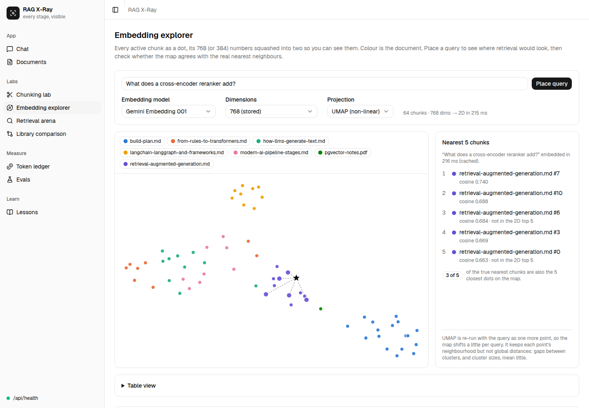
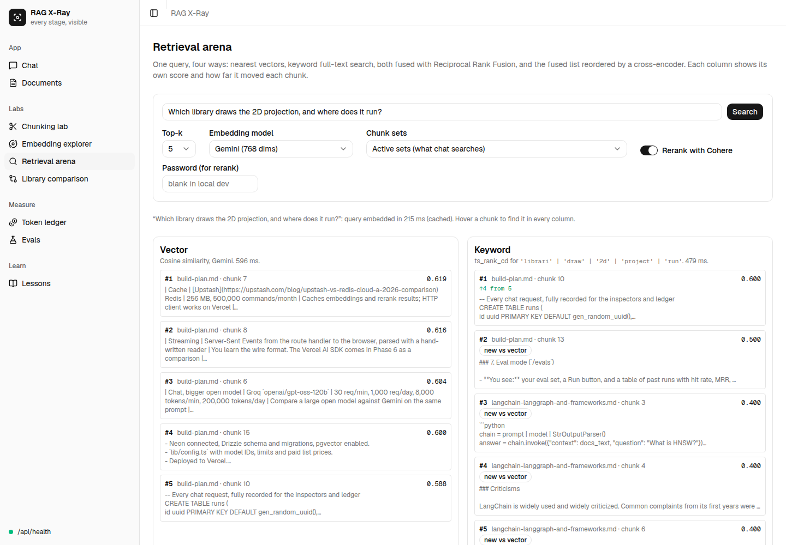
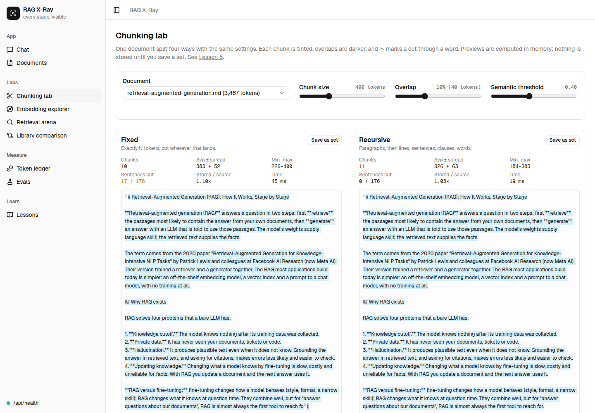
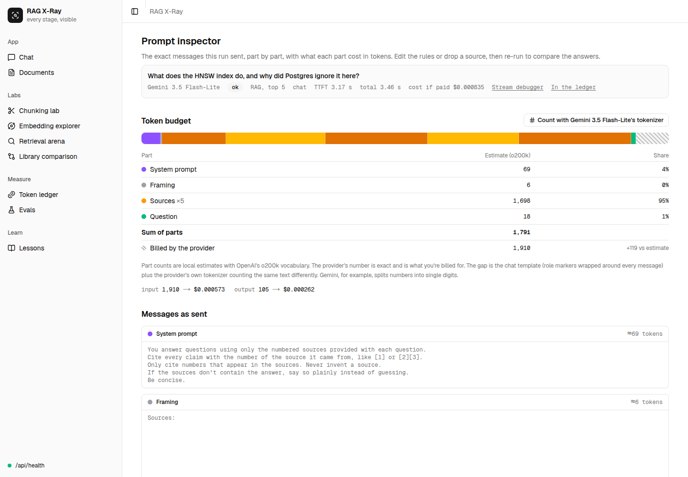
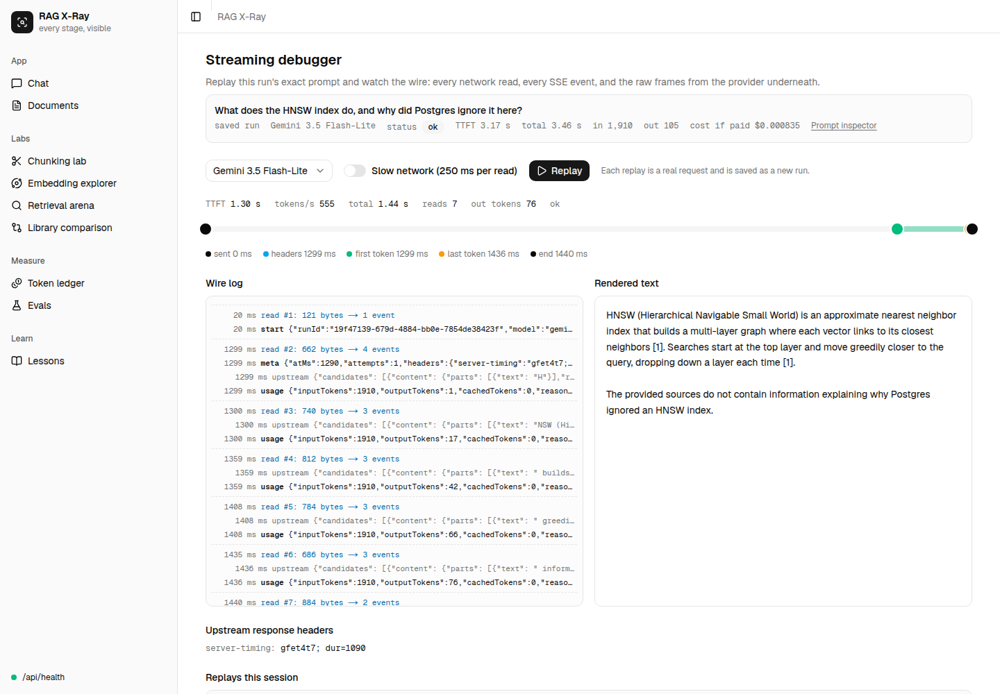
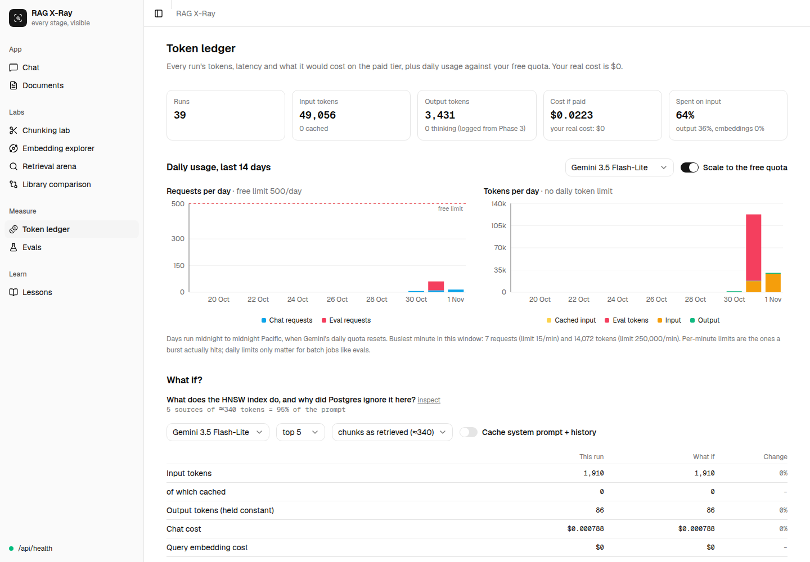
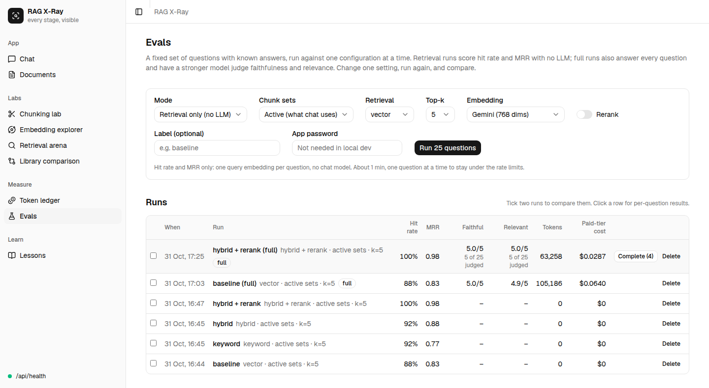
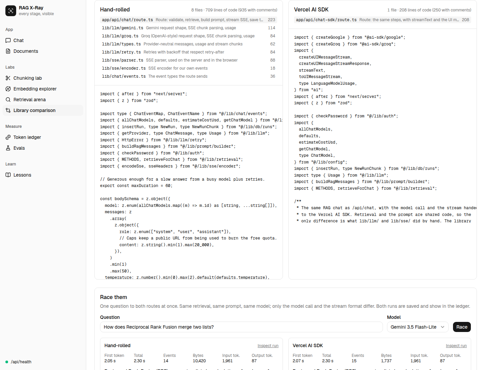
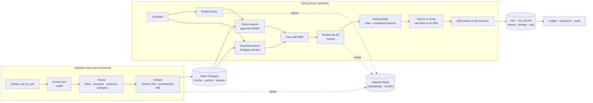

# RAG X-Ray

A chat-over-your-documents app where every stage of retrieval-augmented generation is visible, adjustable and measured. Change one setting (chunk size, embedding model, retrieval method, reranking, prompt, model) and watch what it does to the chunks, the ranking, the prompt, the tokens, the latency and the eval scores.

The chat is the shell. The labs around it are the product, and the [Learn](content/learn) pages explain each stage with real numbers from this app.

- **Hand-rolled first.** Every LLM, embedding, rerank and streaming call is plain `fetch`, with a hand-written SSE parser. The same chat is then rewritten on the Vercel AI SDK so you can compare the two.
- **Every number is shown.** Tokens, scores, latency and paid-tier cost appear next to whatever produced them.
- **Zero cost.** Gemini, Groq, Cohere, Neon, Upstash and Vercel free tiers, with no card.



## What's inside

| Page                                       | What you see                                                                                                                                                                        |
| ------------------------------------------ | ----------------------------------------------------------------------------------------------------------------------------------------------------------------------------------- |
| **Chat** `/chat`                           | Cited answers from Gemini or Groq, streamed token by token, with vector, keyword or hybrid retrieval and optional reranking. Every answer links to its inspectors.                  |
| **Documents** `/documents`                 | Upload `.md`, `.txt` or `.pdf`; text is extracted, chunked, embedded (cached in Redis) and stored in pgvector.                                                                      |
| **Chunking lab** `/lab/chunking`           | One document split four ways (fixed, recursive, sentence, semantic) with boundaries, overlaps and mid-word cuts highlighted.                                                        |
| **Embedding explorer** `/lab/embeddings`   | Every chunk in 2D (UMAP or PCA, in the browser), a query star linked to its true nearest chunks, 768 vs 256 dims, and a similarity playground for synonyms, negation and languages. |
| **Retrieval arena** `/lab/retrieval`       | One query through vector, keyword, hybrid (RRF) and hybrid + Cohere rerank, side by side, with each chunk's rank movement.                                                          |
| **Library comparison** `/lab/sdk`          | The hand-rolled chat route next to the same route on the Vercel AI SDK, with line counts and a live race on the wire.                                                               |
| **Prompt inspector** `/runs/[id]/prompt`   | The exact messages sent, with a token bar per part; edit the rules or drop a source and re-run.                                                                                     |
| **Streaming debugger** `/runs/[id]/stream` | Every network read, SSE event and raw provider frame on a timeline: time to first token, tokens per second, back-pressure.                                                          |
| **Token ledger** `/ledger`                 | Every run's tokens, latency and paid-tier cost, daily usage against the free quotas, and a what-if re-pricing panel.                                                                |
| **Evals** `/evals`                         | A 25-question eval set: hit rate and MRR without an LLM, faithfulness and relevance with an LLM judge, and a compare view.                                                          |
| **Learn** `/learn`                         | Fourteen lessons, one per concept, each with "try it" links into the app and the numbers you should see.                                                                            |

<details>
<summary>More screenshots</summary>









</details>

## Architecture

One Next.js app does everything. Two pipelines share one Postgres database: ingestion runs once per document, and the query pipeline runs on every question and records each step in `runs`.



Measured on one question with hybrid retrieval and rerank ([Lesson 13](content/learn/full-pipeline.mdx)): embed 869 ms, search 557 ms, rerank 975 ms, first token 766 ms later, 105 tokens in 285 ms, 3.5 s in total. With the embedding and rerank cached, the same question took 1.5 s.

| Area          | Choice                                                                     | Why                                                                        |
| ------------- | -------------------------------------------------------------------------- | -------------------------------------------------------------------------- |
| Framework     | Next.js 16 (App Router, Cache Components), TypeScript, Tailwind, shadcn/ui | One app for UI, API routes and ingestion                                   |
| LLMs          | Gemini 3.5 Flash-Lite and 3.8 Flash, Groq GPT-OSS 20B and 120B             | Two API shapes, both on free tiers; IDs and prices live in `lib/config.ts` |
| Embeddings    | `gemini-embedding-001` at 768 dims; `all-MiniLM-L6-v2` via Transformers.js | An API model and one running in-process, to compare                        |
| Vectors       | pgvector on Neon, cosine distance, HNSW                                    | Vectors next to the data, queried in plain SQL                             |
| Keyword       | Postgres full-text search, `ts_rank_cd`                                    | A BM25 stand-in with no extra service                                      |
| Hybrid        | Reciprocal Rank Fusion, k = 60                                             | Merges ranks, so no score normalisation                                    |
| Reranker      | Cohere `rerank-v5.0-fast`, cached                                          | A cross-encoder on the top 20                                              |
| Cache         | Upstash Redis over HTTP                                                    | Embeddings and reranks keyed by content hash                               |
| Streaming     | Hand-written SSE encoder and parser; AI SDK v7 on `/api/chat-sdk`          | Learn the wire format, then compare with a library                         |
| 2D projection | `umap-js` in the browser, hand-written PCA                                 | No server work, and the maths is visible                                   |

## Setup

Requires Node 22+ and pnpm.

```bash
pnpm install
cp .env.example .env.local   # then fill in the values
pnpm db:migrate              # enables pgvector and creates the tables in Neon
pnpm dev
```

Open http://localhost:3000, upload a few documents on **Documents**, and ask a question in **Chat** with **Use documents** on. `GET /api/health` reports database latency and the pgvector version.

| Variable                                             | Where to get it                                                    | Needed for                                                      |
| ---------------------------------------------------- | ------------------------------------------------------------------ | --------------------------------------------------------------- |
| `GEMINI_API_KEY`                                     | [Google AI Studio](https://aistudio.google.com), no billing linked | chat, embeddings, eval judge                                    |
| `GROQ_API_KEY`                                       | [Groq console](https://console.groq.com)                           | the Groq models                                                 |
| `COHERE_API_KEY`                                     | [Cohere dashboard](https://dashboard.cohere.com) (trial key)       | reranking                                                       |
| `DATABASE_URL`, `DATABASE_URL_UNPOOLED`              | [Neon](https://neon.com): pooled and direct strings                | everything                                                      |
| `UPSTASH_REDIS_REST_URL`, `UPSTASH_REDIS_REST_TOKEN` | [Upstash](https://upstash.com) Redis                               | the embedding and rerank cache                                  |
| `APP_PASSWORD`                                       | any string                                                         | uploads, rerank and eval runs in production (open in local dev) |

The local embedding model (~90 MB) downloads from Hugging Face on first use into `.cache/transformers/`. Gemini's free tier may use your inputs to improve Google's models, so upload only non-confidential documents.

## Scripts

| Script                            | What it does                                   |
| --------------------------------- | ---------------------------------------------- |
| `pnpm dev` / `build` / `start`    | Next.js                                        |
| `pnpm lint` / `typecheck`         | ESLint, and `tsc` after generating route types |
| `pnpm format` / `format:check`    | Prettier                                       |
| `pnpm test`                       | Vitest (pure logic only; API calls are mocked) |
| `pnpm db:generate` / `db:migrate` | Drizzle migrations from `lib/db/schema.ts`     |

## Layout

- `app/(app)/*`: pages behind the sidebar; `app/api/*`: route handlers (`chat`, `chat-sdk`, `ingest`, `retrieve`, `embeddings`, `evals`, …)
- `lib/config.ts`: every model ID, free-tier limit and paid list price
- `lib/llm/`: Gemini and Groq adapters over plain `fetch`, retries, usage normalisation
- `lib/sse/`: the SSE encoder and the parser used on both server and browser
- `lib/embeddings/`, `lib/chunking/`, `lib/retrieval/`, `lib/prompt/`, `lib/evals/`: one folder per pipeline stage
- `lib/projection/pca.ts`: PCA by power iteration, for the explorer
- `lib/db/`: Drizzle schema, the Neon client, and the raw SQL for search
- `content/learn/`: the lessons (MDX); `content/corpus/`: the sample documents; `content/evals/`: the eval set
- `docs/`: the [build plan](docs/RAG%20X-Ray%20—%20Build%20Plan.md), phase handoffs and screenshots

## Lessons

1. How an LLM API call works · 2. Tokens and tokenisers · 3. Streaming · 4. Embeddings · 5. Chunking · 6. Vector databases · 7. Keyword search and hybrid retrieval · 8. Reranking · 9. Prompt construction · 10. Evaluating RAG · 11. Caching and cost control · 12. Libraries vs hand-rolled · 13. The full pipeline · 14. [Process log](content/learn/process-log.mdx): what was decided, what broke, and why
